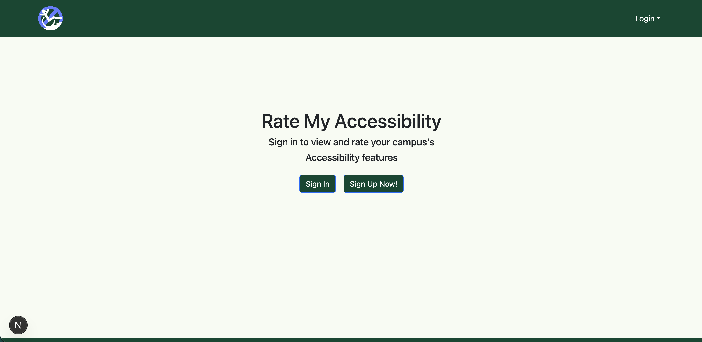
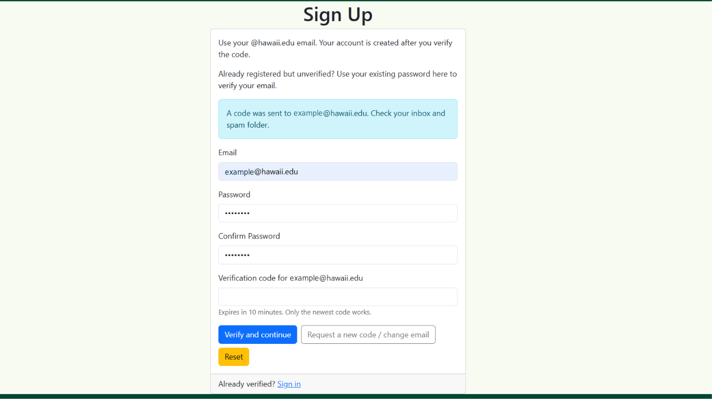
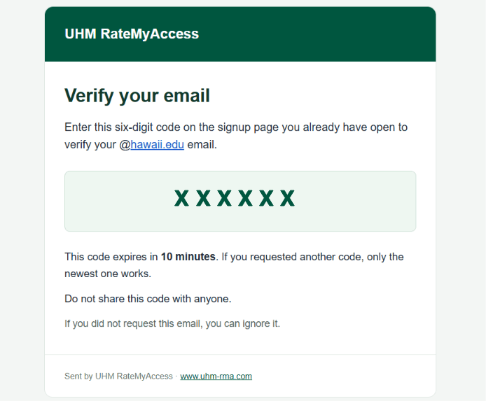
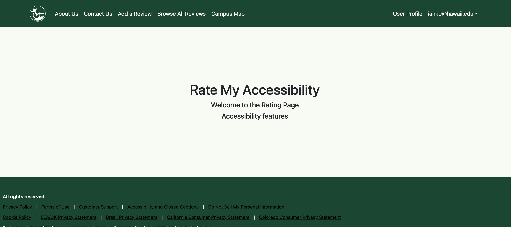
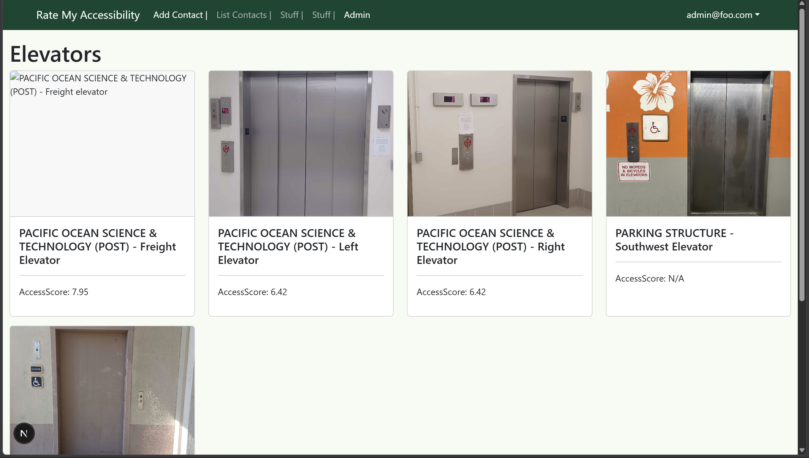
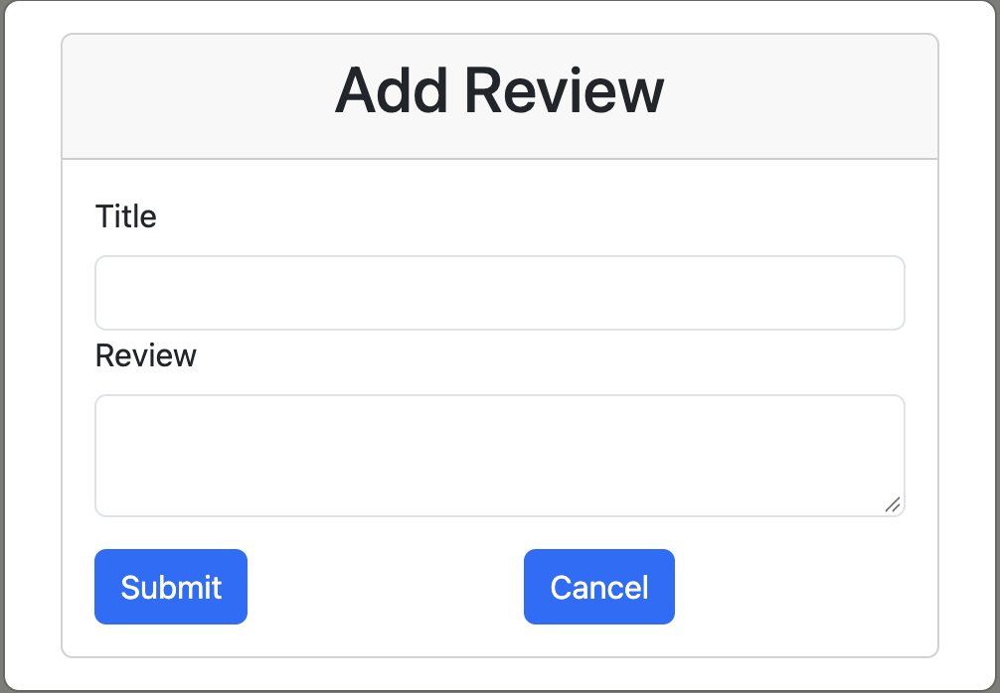
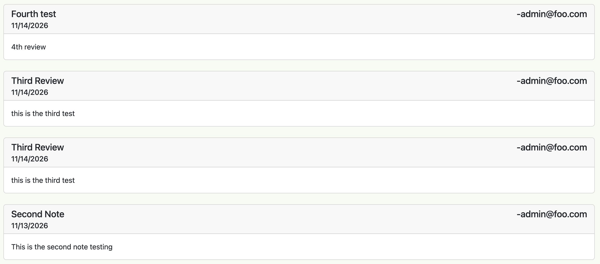
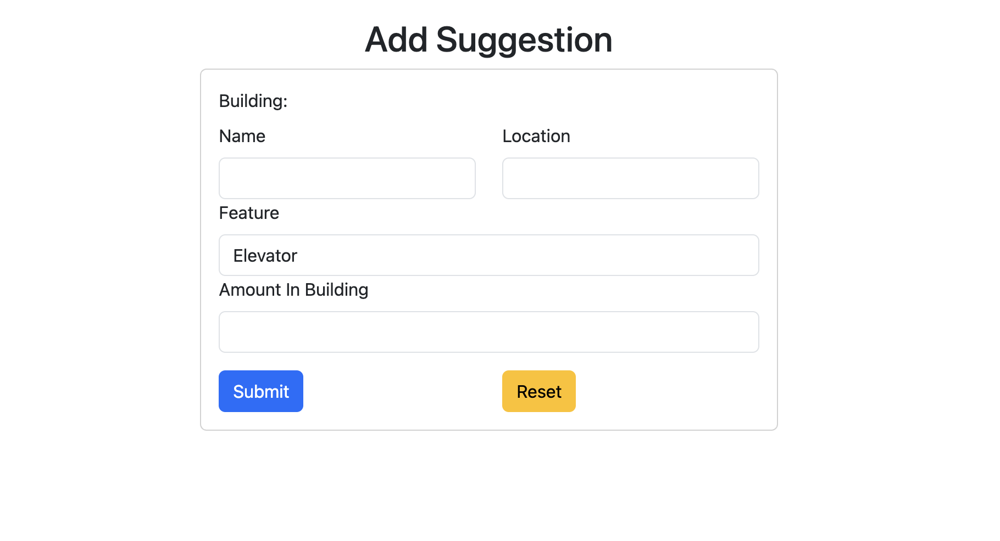
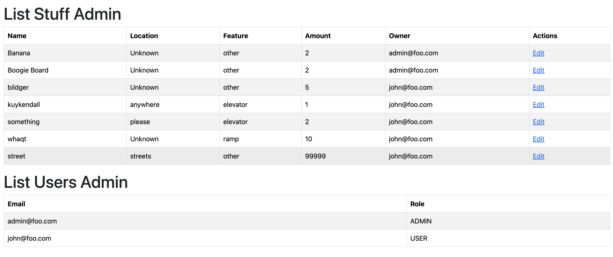

<h1 align="center">Overview</h1>

Accessibility is an important part of creating an inclusive and welcoming environment for everyone at the University of Hawaiʻi campuses. Features such as elevators, wheelchair ramps, accessible parking spaces, and pathways help students, faculty, and visitors navigate campus safely and comfortably. However, not all accessibility features are easy to locate, and their conditions may vary across campus. Some may be difficult to use, poorly maintained, or not widely known, making it challenging for individuals to find accessible routes and facilities.

Our project aims to address these issues by creating an interactive accessibility rating map that allows students and other campus members to locate, review, and rate accessibility features throughout the UH campuses. By sharing their experiences, users can help others identify reliable accessibility options while also highlighting areas that need improvement. Through community participation, this map will provide useful information about campus accessibility and encourage improvements that make UH campuses more accessible and inclusive for everyone.

<h1 align="center">Project Links</h1>

Here are our current project links to the repository and various documentation:

  [Github Organization](https://github.com/Rate-My-Accessibility) 
  
  [App Repository](https://github.com/Rate-My-Accessibility/Rate-My-Accessibility) 
  
  [Documentation Repository](https://github.com/Rate-My-Accessibility/Rate-My-Accessibility.github.io) 
  
  [Documentation Site (this page)](https://rate-my-accessibility.github.io) 

<h1 align="center">Team Contract</h1>

The team contract guarantees than everyone does their fair share of work.

[Read our signed team contract](https://docs.google.com/document/d/1PwLfdrM0iN4LY57Lhffm3X8wBJvDrR92dHVqINEadZ0/edit?usp=sharing).

<h1 align="center">Deployment</h1>

[Vercel Deployment](https://rate-my-accessibility-application.vercel.app)

Custom domain at [uhm-rma.com](https://www.uhm-rma.com)

<h1 align="center">User Guide</h1>
Here's a quick introduction to the pages and how to get started with Rate My Accessibility.

Landing Page: What you'll see upon opening the webpage:

Users are only allowed view the campus map and view past reviews if they have registered an account using their UH email.

<h3>Account Creation Process</h3>

You will be prompted to input a verification code that you will receive in roughly 5 minutes to finalize the account creation process.
Here is what the verification code email looks like:

This is the main homepage. You can add a review, browse all reviews, view the campus map, and view your user profile:

You can browse elevators on the list page to view their AccessScore values, see representative images, and later open their individual pages to add reviews.

You can add reviews by selecting a location on the map and rate its features as well as provide a short written description.
Example of what a review on an elevator might look like:

This is an example of what the add Review form will look like

You can also browse all your reviews

<h3>Adding Suggestions</h3>

A user can suggest a new accessibility feature, and it can be reviewed by an admin.

<h1 align="center">Milestones</h1>

[Milestone 1 Project Page](https://github.com/orgs/Rate-My-Accessibility/projects/1)

[Milestone 2 Project Page](https://github.com/orgs/Rate-My-Accessibility/projects/3/views/1)

<h1 align="center">Contact Us</h1>

Mace Mori (mmori6@hawaii.edu)

Donovan Tapper (tapperd@hawaii.edu)

Maximo Vicente (maximovi@hawaii.edu) 

Ian Kubo (iank9@hawaii.edu)

Nathan Leung (nathankl@hawaii.edu) 

