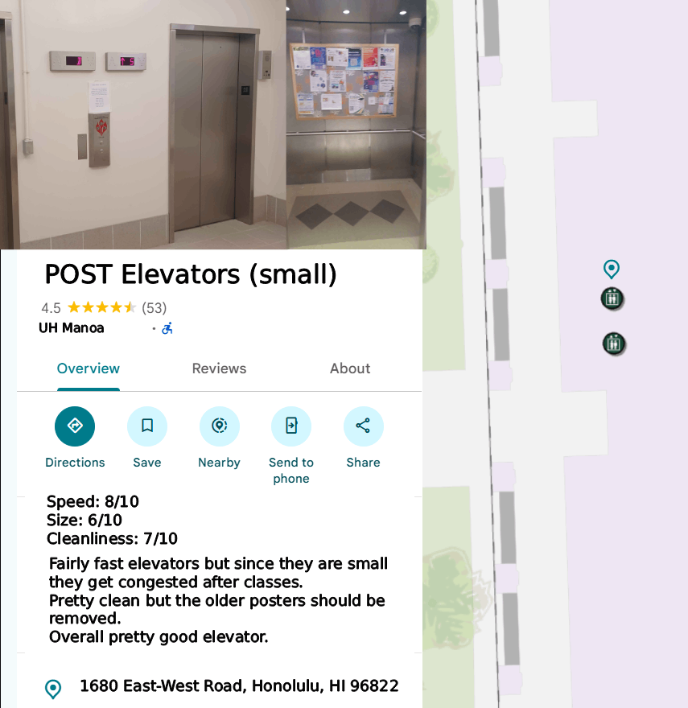

### Rate My Accessibility

### Overview

Problem: Accessibility features like elevators, wheelchair ramps, and accessible parking spaces are important parts of making the UH campuses accessible to everyone. However, not all of these features are well known across the campus nor are they of the same quality.

Solution: Creating a rating map allows students to collectively bring attention to what works well on campus for people but also bring attention to what needs to be improved on campus.

### Project Links

[Github Organization](https://github.com/Rate-My-Accessibility)

[App Repository](https://github.com/Rate-My-Accessibility/Rate-My-Accessibility)

[Documentation Repository](https://github.com/Rate-My-Accessibility/Rate-My-Accessibility.github.io)

[Documentation Site (this page)](https://rate-my-accessibility.github.io)

### Team Contract

[Read our signed team contract](https://docs.google.com/document/d/1PwLfdrM0iN4LY57Lhffm3X8wBJvDrR92dHVqINEadZ0/edit?usp=sharing).

### Deployment

(to be hosted on vercel)

### User Guide

(Page instructions and mockups here)

Example of what a review on an elevator might look like:

