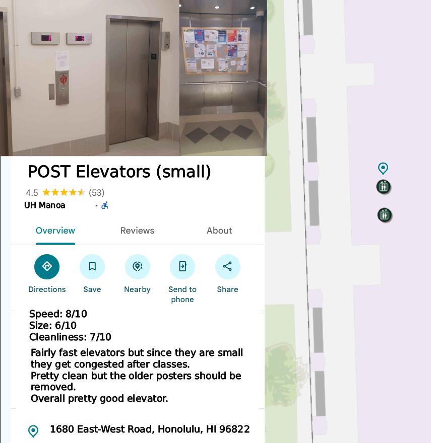

### Rate My Accessibility

### Overview

Problem: Accessibility features like elevators, wheelchair ramps, and accessible parking spaces are important parts of making the UH campuses accessible to everyone. However, not all of these features are well known across the campus nor are they of the same quality.

Solution: Creating a rating map allows students to collectively bring attention to what works well on campus for people but also bring attention to what needs to be improved on campus.

### Project Links

[Github Organization](https://github.com/Rate-My-Accessibility)

[App Repository](https://github.com/Rate-My-Accessibility/Rate-My-Accessibility)

[Documentation Repository](https://github.com/Rate-My-Accessibility/Rate-My-Accessibility.github.io)

[Documentation Site (this page)](https://rate-my-accessibility.github.io)

### Team Contract

[Read our signed team contract](https://docs.google.com/document/d/1PwLfdrM0iN4LY57Lhffm3X8wBJvDrR92dHVqINEadZ0/edit?usp=sharing).

### Deployment

[Vercel Deployment]()

Custom domain at [uhm-rma.com](https://www.uhm-rma.com)

### User Guide

Landing Page: What you'll see when you open the webpage
(Page instructions and mockups here)

You can view the map and the reviews without logging in.

In order to create reviews, you will need to sign up using your @hawaii.edu account.

You will be asked to input a verification code that you will receive in roughly 5 minutes to finalize the account creation process.
Here is what the verification code email looks like:

Example of what a review on an elevator might look like:

